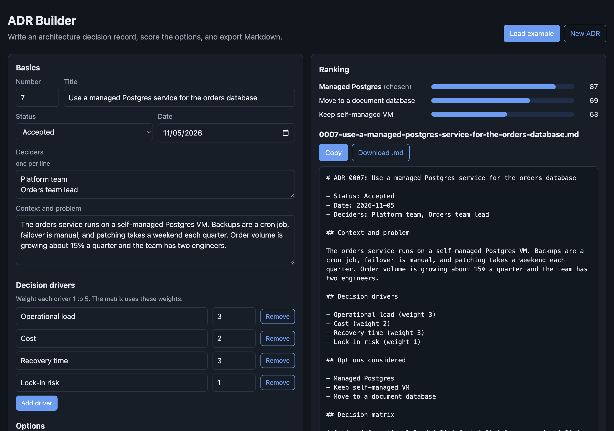

# ADR Builder

A small browser tool for writing architecture decision records (ADRs). You describe the problem, list the options, weight the decision drivers, and score each option. The tool ranks the options, flags gaps, and exports a clean Markdown file you can commit next to your code.



## Why

Teams make big technical calls in meetings and chat threads, and six months later nobody remembers why. An ADR is a short document that records one decision, the options that were on the table, and the tradeoffs. Writing one takes ten minutes if the structure is ready.

This tool adds a weighted decision matrix to the usual ADR template. It makes the tradeoffs explicit, and it calls out the case where the team picks an option the matrix ranks lower. That is often fine, but the rationale should say why.

## Features

- Form for the standard sections: context, drivers, options, decision, consequences, links.
- Weighted scoring from 0 to 5 per driver, scaled to a 0 to 100 score per option.
- Live ranking chart and live Markdown preview.
- Checks for common gaps: one-option "decisions", duplicate names, a missing superseding ADR.
- Copy to clipboard or download as `NNNN-title-slug.md`.
- Drafts autosave in the browser on your device. Nothing leaves the page.

## Run it

It is a static site with no build step and no dependencies.

- **GitHub Pages:** enable Pages for the repo and serve from the root of the default branch.
- **Locally:** ES modules need a web server, so `file://` will not work. From this folder run:

```bash
python3 -m http.server 8000
```

Then open http://localhost:8000.

## Tests

The scoring and Markdown logic lives in `src/adr.js` with no DOM access, so it runs under Node's built-in test runner. Node 18 or newer is enough, with no packages to install.

```bash
npm test
```

## Layout

```
index.html        page shell
src/adr.js        pure logic: scoring, validation, Markdown
src/app.js        DOM wiring and local draft storage
src/styles.css    styles, light and dark
tests/            node:test suite
```

## Output format

The Markdown loosely follows [MADR](https://adr.github.io/madr/), with an added decision matrix table. Files are numbered and slugged, for example `0007-use-a-managed-postgres-service-for-the-orders-database.md`, so they sort in decision order in a `docs/adr/` folder.

## License

MIT. See [LICENSE](LICENSE).
